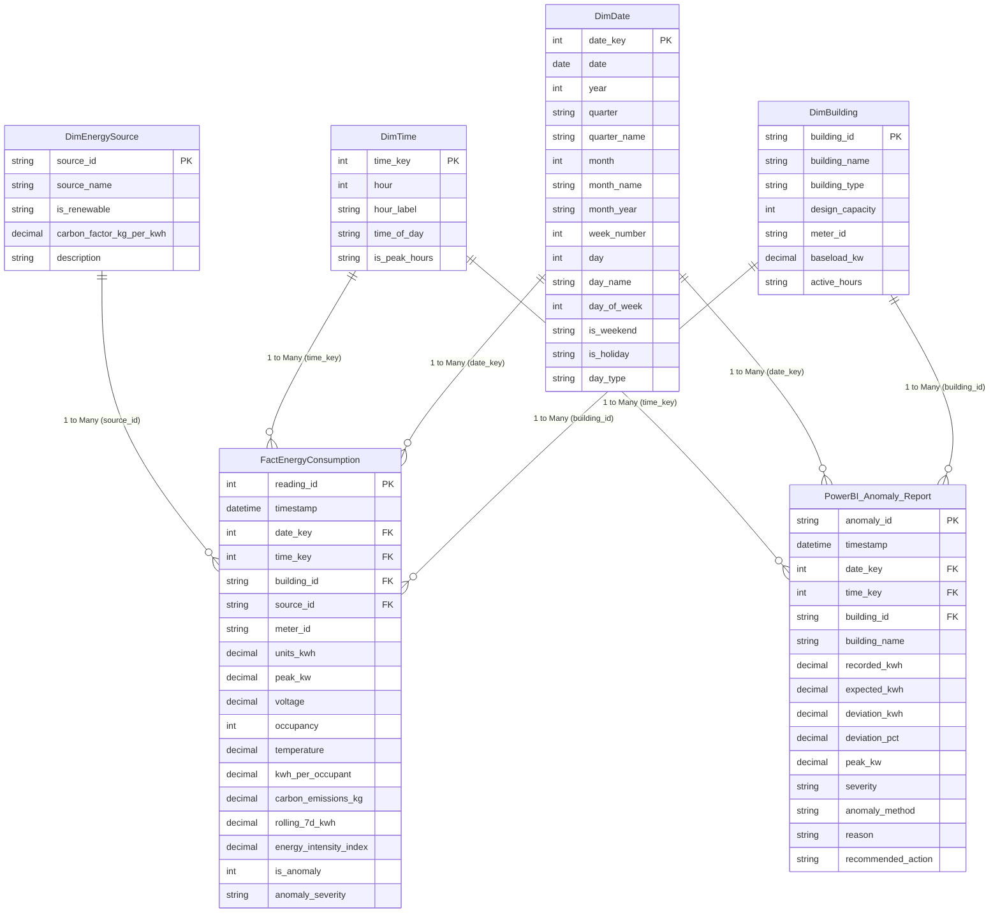

# Microsoft Power BI Star Schema Data Model Documentation

This document specifies the enterprise Star Schema architecture designed for the **Campus Energy Consumption Monitoring and Analytics Dashboard**.

---

## 1. Architectural Overview

The analytical data model follows **Kimball Dimensional Modeling** best practices configured in a pure **Star Schema**. 

In this architecture:
- A single centralized **Fact Table** (`FactEnergyConsumption`) contains numerical additive measurements, telemetry observations, and surrogate foreign keys.
- Surrounding **Dimension Tables** (`DimBuilding`, `DimDate`, `DimTime`, `DimEnergySource`) store descriptive context, hierarchies, and filtering attributes.
- A specialized **Diagnostic Table** (`PowerBI_Anomaly_Report`) captures statistical anomalies and operational recommendations.

---

## 2. Table Specifications & Cardinalities

### 2.1 Fact Table: `FactEnergyConsumption`
- **Grain:** One row per hourly submeter telemetry observation per facility.
- **Storage Mode:** Import Mode.
- **Row Count:** ~15,112 rows (covering 90 calendar days across 7 facilities).

| Column Name | Data Type | Constraint | Description |
|---|---|---|---|
| `reading_id` | Whole Number (Integer) | Primary Key | Unique surrogate key identifying each hourly telemetry observation. |
| `timestamp` | Date/Time | Measurement | ISO 8601 reading timestamp (`YYYY-MM-DD HH:MM:SS`). |
| `date_key` | Whole Number (Integer) | Foreign Key | Integer representation of calendar date (`YYYYMMDD`) -> `DimDate[date_key]`. |
| `time_key` | Whole Number (Integer) | Foreign Key | Integer diurnal time key (`HH00`) -> `DimTime[time_key]`. |
| `building_id` | Text | Foreign Key | Facility identifier (`BLD01`–`BLD07`) -> `DimBuilding[building_id]`. |
| `source_id` | Text | Foreign Key | Power generation source key (`SRC01`–`SRC03`) -> `DimEnergySource[source_id]`. |
| `meter_id` | Text | Hardware ID | Physical hardware submeter serial tag. |
| `units_kwh` | Decimal Number | Additive Measure | Hourly active electricity consumed in kilowatt-hours (kWh). |
| `peak_kw` | Decimal Number | Semi-Additive | Maximum instantaneous demand registered during the hour in kilowatts (kW). |
| `voltage` | Decimal Number | Non-Additive | Line supply voltage (nominal 230V single phase). |
| `occupancy` | Whole Number (Integer) | Non-Additive | Facility sensor headcount. |
| `temperature` | Decimal Number | Environmental | Ambient outdoor temperature in °C. |
| `kwh_per_occupant` | Decimal Number | Calculated | Energy consumed per occupant (`units_kwh / max(1, occupancy)`). |
| `carbon_emissions_kg` | Decimal Number | Environmental | Estimated CO2 emissions (`units_kwh * carbon_factor`). |
| `rolling_7d_kwh` | Decimal Number | Trend | Trailing 7-day (168-hour) facility moving average. |
| `energy_intensity_index` | Decimal Number | Indicator | Ratio of current consumption to rolling 7-day baseline. |
| `is_anomaly` | Whole Number | Flag | Binary flag (`1` = Anomaly event, `0` = Normal). |
| `anomaly_severity` | Text | Classification | Categorical severity tag (`None`, `Low`, `Medium`, `High`, `Critical`). |

---

### 2.2 Dimension Table: `DimBuilding`
- **Grain:** One row per physical campus facility.
- **Primary Key:** `building_id` (`BLD01` through `BLD07`).

| Column Name | Data Type | Description | Example Values |
|---|---|---|---|
| `building_id` | Text (PK) | Alphanumeric surrogate key. | `BLD01`, `BLD02`, `BLD03` |
| `building_name` | Text | Full legal facility title. | `Academic Block`, `Library`, `Canteen` |
| `building_type` | Text | Institutional functional class. | `Academic & Teaching`, `Technology & Computing` |
| `design_capacity` | Whole Number | Maximum design headcount. | `800`, `600`, `450`, `300` |
| `meter_id` | Text | Main hardware meter code. | `MTR-BLD01`, `MTR-BLD02` |
| `baseload_kw` | Decimal Number | Minimum continuous idle power. | `45.0`, `70.0`, `25.0` |
| `active_hours` | Text | Scheduled weekday operational window. | `08:00 - 18:00`, `08:00 - 20:00` |

---

### 2.3 Dimension Table: `DimDate`
- **Grain:** One row per calendar day.
- **Primary Key:** `date_key` (`YYYYMMDD`).
- **Date Hierarchy:** `Year` > `Quarter` > `Month` > `Date`.

| Column Name | Data Type | Sort By Column | Description |
|---|---|---|---|
| `date_key` | Whole Number (PK) | - | Integer date identifier (`20261015`). |
| `date` | Date | - | Calendar date (`2026-10-15`). |
| `year` | Whole Number | - | Calendar year (`2026`). |
| `quarter` | Text | - | Fiscal quarter (`Q1`, `Q2`, `Q3`, `Q4`). |
| `quarter_name` | Text | - | Full quarter name (`2026 Q4`). |
| `month` | Whole Number | - | Month number (`1` to `12`). |
| `month_name` | Text | `month` | Full month name (`October`). **Sorted by `month`!** |
| `month_year` | Text | `date_key` | Month abbreviation with year (`Oct 2026`). |
| `week_number` | Whole Number | - | ISO calendar week number (`1` to `52`). |
| `day` | Whole Number | - | Day of the month (`1` to `31`). |
| `day_name` | Text | `day_of_week` | Day name (`Thursday`). **Sorted by `day_of_week`!** |
| `day_of_week` | Whole Number | - | Day of week number (`1` = Monday, `7` = Sunday). |
| `is_weekend` | Text | - | Binary weekend indicator (`Yes` / `No`). |
| `is_holiday` | Text | - | Scheduled holiday indicator (`Yes` / `No`). |
| `day_type` | Text | - | Operational slicer (`Weekday`, `Weekend`, `Holiday`). |

---

### 2.4 Dimension Table: `DimTime`
- **Grain:** One row per hour of the day (24 rows).
- **Primary Key:** `time_key` (`0` to `2300`).

| Column Name | Data Type | Sort By Column | Description |
|---|---|---|---|
| `time_key` | Whole Number (PK) | - | Diurnal time integer (`0`, `100`, ... `2300`). |
| `hour` | Whole Number | - | 24-hour military hour (`0` to `23`). |
| `hour_label` | Text | `hour` | Hour display string (`00:00`, `14:00`). **Sorted by `hour`!** |
| `time_of_day` | Text | `hour` | Classification (`Morning`, `Afternoon`, `Evening`, `Night`). |
| `is_peak_hours` | Text | - | Peak demand flag (`Yes` for 10:00–16:00, else `No`). |

---

### 2.5 Dimension Table: `DimEnergySource`
- **Grain:** One row per electricity source.
- **Primary Key:** `source_id` (`SRC01`–`SRC03`).

| Column Name | Data Type | Description |
|---|---|---|
| `source_id` | Text (PK) | Alphanumeric source key (`SRC01`, `SRC02`, `SRC03`). |
| `source_name` | Text | Source label (`Grid`, `Solar`, `Generator`). |
| `is_renewable` | Text | Sustainability indicator (`Yes` / `No`). |
| `carbon_factor_kg_per_kwh` | Decimal Number | Emissions intensity factor (Grid = 0.82, Solar = 0.00, Generator = 0.95). |
| `description` | Text | Operational notes on supply channel. |

---

## 3. Power BI Relationship Matrix

| Primary Table (Dimension - 1) | Foreign Key Table (Fact - *) | Primary Key Column | Foreign Key Column | Cardinality | Filter Direction |
|---|---|---|---|---|---|
| `DimBuilding` | `FactEnergyConsumption` | `building_id` | `building_id` | 1 to Many (1:*) | Single (`DimBuilding` filters `Fact`) |
| `DimDate` | `FactEnergyConsumption` | `date_key` | `date_key` | 1 to Many (1:*) | Single (`DimDate` filters `Fact`) |
| `DimTime` | `FactEnergyConsumption` | `time_key` | `time_key` | 1 to Many (1:*) | Single (`DimTime` filters `Fact`) |
| `DimEnergySource` | `FactEnergyConsumption` | `source_id` | `source_id` | 1 to Many (1:*) | Single (`DimEnergySource` filters `Fact`) |
| `DimBuilding` | `PowerBI_Anomaly_Report` | `building_id` | `building_id` | 1 to Many (1:*) | Single (`DimBuilding` filters `Anomaly`) |
| `DimDate` | `PowerBI_Anomaly_Report` | `date_key` | `date_key` | 1 to Many (1:*) | Single (`DimDate` filters `Anomaly`) |
| `DimTime` | `PowerBI_Anomaly_Report` | `time_key` | `time_key` | 1 to Many (1:*) | Single (`DimTime` filters `Anomaly`) |

> **IMPORTANT MODELING RULE:**  
> Never enable bi-directional cross-filtering between dimension and fact tables in this model. Single directional filtering ensures ambiguity-free DAX context transition, prevents circular relationships, and optimizes VertiPaq compression.

---

## 4. Column Sorting Specifications (Sort By Column)

To ensure chronological and ordinal sorting in Power BI visual charts, configure these column sort properties in the **Data View**:

1. In `DimDate`, select `month_name` -> Modeling tab -> **Sort by column** -> select `month`.
2. In `DimDate`, select `day_name` -> Modeling tab -> **Sort by column** -> select `day_of_week`.
3. In `DimDate`, select `month_year` -> Modeling tab -> **Sort by column** -> select `date_key`.
4. In `DimTime`, select `hour_label` -> Modeling tab -> **Sort by column** -> select `hour`.
5. In `DimTime`, select `time_of_day` -> Modeling tab -> **Sort by column** -> select `hour`.

